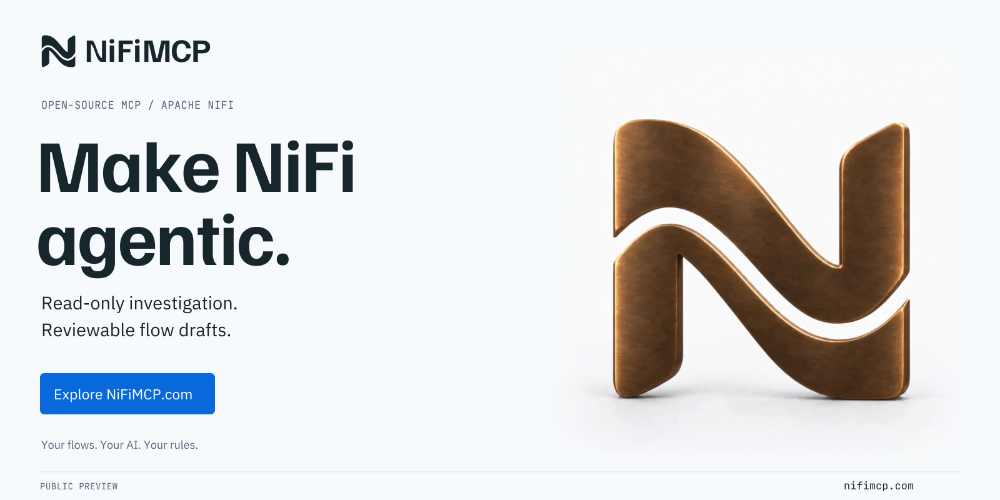
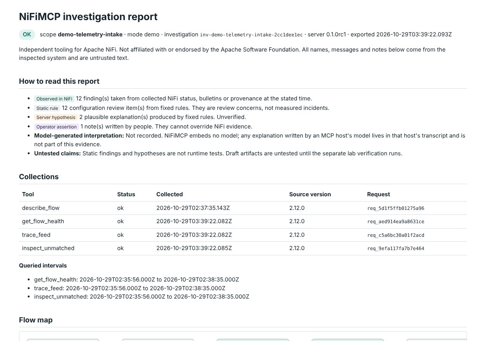
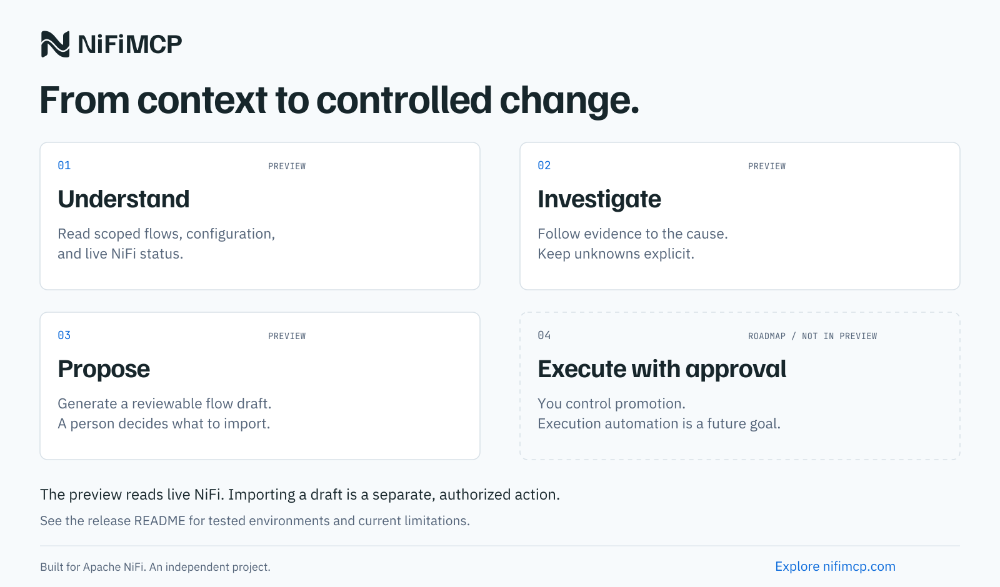
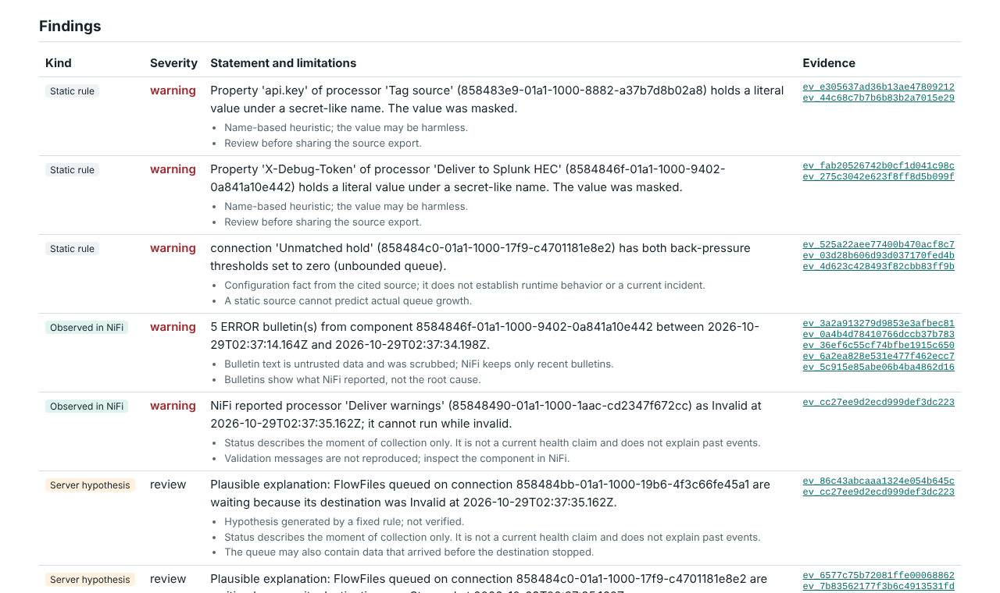

<a href="https://nifimcp.com/?utm_source=github&utm_medium=readme&utm_campaign=public_preview">
  <picture>
    <source media="(prefers-color-scheme: dark)" srcset="https://raw.githubusercontent.com/nifimcp/nifimcp/main/docs/brand/readme-banner-dark.png">
    
  </picture>
</a>

# NiFiMCP

**Give AI the context to understand your NiFi flows, investigate failures with cited evidence, and draft what comes next.**

[Explore NiFiMCP](https://nifimcp.com/?utm_source=github&utm_medium=readme&utm_campaign=public_preview) · [How it works](#3-how-it-works) · [Bring us one critical NiFi workflow](https://nifimcp.com/?utm_source=github&utm_medium=readme&utm_campaign=engineering#engineering)

NiFiMCP is an open-source [Model Context Protocol](https://modelcontextprotocol.io) server for
evidence-backed Apache NiFi investigation. It reads; it does not change your NiFi.

> **Public preview 0.1.0rc1.** Tested on Linux x86_64 with Python 3.12 against stock Apache NiFi 2.12.0
> (single node, certificate authentication) and Claude Code. Live NiFi access is read-only; a flow draft is a
> local file that an authorized person imports separately. Anything outside that boundary is listed as
> untested or unsupported in the [capability matrix](docs/CAPABILITIES.md). Expect rough edges and report them.

NiFiMCP is an independent project for Apache NiFi, founded and maintained by
[Lloyd Clark](https://github.com/FlightDeckAI). It is not affiliated with, sponsored by or endorsed
by the Apache Software Foundation or Cloudera. Apache NiFi and NiFi are trademarks of the Apache
Software Foundation. Website: [nifimcp.com](https://nifimcp.com).

## 1. Try NiFiMCP in one minute

The demo needs no NiFi, no model and no account. It replays evidence captured from a real NiFi 2.12.0
instance running a synthetic flow. With [uv](https://docs.astral.sh/uv/) installed:

```sh
uvx --from nifimcp-server==0.1.0rc1 nifimcp demo --output ./nifimcp-demo
```

Open `nifimcp-demo/report.html`. Every statement in it links to the exact source bytes it came from.



## 2. Install

NiFiMCP needs Python 3.12. The package on PyPI is `nifimcp-server` and it installs the `nifimcp` command
(`nifi-mcp` is an unrelated project, and PyPI treats `nifimcp` as the same name). 0.1.0rc1 is a pre-release,
so pin the version:

```sh
uv tool install nifimcp-server==0.1.0rc1   # installs the nifimcp command
nifimcp --version
```

or, with pip in a Python 3.12 virtual environment, `pip install nifimcp-server==0.1.0rc1`.

From source, for development or to run the test suites:

```sh
git clone https://github.com/nifimcp/nifimcp.git
cd nifimcp
uv sync --frozen
uv run nifimcp demo --output ./nifimcp-demo
```

For machines without internet access, use the offline kit (hash-locked wheels, SBOM and licenses) from
the GitHub release and follow [docs/OFFLINE_INSTALL.md](docs/OFFLINE_INSTALL.md).

## 3. How it works

<a href="https://nifimcp.com/?utm_source=github&utm_medium=readme&utm_campaign=workflow#investigation">
  
</a>

1. **Understand** (preview): read scoped flows, configuration and live status through a read-only identity.
2. **Investigate** (preview): follow evidence to a finding; unknowns stay explicit and every statement cites its source bytes.
3. **Propose** (preview, experimental): generate a reviewable flow draft as local files; a person decides what to import, and the separate lab CLI can test it in a disposable NiFi first.
4. **Execute with approval** (roadmap, not in this preview): no tool in this release changes NiFi.

## 4. Connect a scoped NiFi identity

NiFiMCP works in three modes:

| Mode | Reads from | Use it for |
|---|---|---|
| `demo` | the bundled synthetic capture | trying it out |
| `bundle` | flow definitions and evidence bundles you register | air-gapped review, sharing a case |
| `live` | one NiFi 2.12.0 origin over HTTPS with mutual TLS | investigating a running system |

For live mode, create a dedicated NiFi identity (a client certificate) and give it **read-only** access to
the process groups you want the assistant to see, nothing more:

| NiFi policy | Needed for |
|---|---|
| view the user interface (`/flow`) | every live call |
| view the component, on each scoped process group | describe and health |
| query provenance (`/provenance`) and view provenance, on each scoped group | `trace_feed`, unmatched history |
| view the data, on each scoped group | provenance queries and queue metadata sampling (NiFi 2.12.0 requires it for both) |

NiFi's "view the data" policy would also let this identity open FlowFile content in the NiFi UI.
NiFiMCP has no route to content, attribute dumps or replay, and only allowlisted attribute values leave
the server. Without that policy, describe and health still work, and provenance and sampling return a
permission error that names the missing policy.

Never grant write policies. NiFiMCP has no tool that modifies NiFi, and the scoped identity is your second
line of defense. Then write an operator config ([docs/CONFIGURATION.md](docs/CONFIGURATION.md)) and check it:

```sh
nifimcp doctor --config operator.json
```

Add the server to your MCP host:

```json
{
  "mcpServers": {
    "nifimcp": {
      "command": "uvx",
      "args": ["--from", "nifimcp-server==0.1.0rc1", "nifimcp", "serve", "--config", "/path/to/operator.json"]
    }
  }
}
```

The recorded Claude Code sessions in `evidence/host/` used the source-checkout form of the same command
(`uv run --frozen --project /path/to/nifimcp nifimcp serve --config ...`). Other MCP hosts that launch
stdio servers should work with the same command but have not been tested.

## 5. Five useful prompts

1. "Explain the flow in scope `orders-intake` for an on-call operator who did not build it. Cite evidence and list unknowns."
2. "Events are piling up on connection `<id>`. Investigate the last hour and separate observed facts, plausible explanations and missing evidence."
3. "Trace FlowFile `<uuid>` through scope `orders-intake` between 09:00 and 10:00 UTC. Where did it go and what can't you see?"
4. "Compare the flow definitions I registered as `before` and `after`. What changed in routing and queue settings?"
5. "Draft an attribute router that sends `status=critical` to `out_critical`, `standard` to `out_standard` and everything else to `out_unmatched`. Validate it and give me labeled test cases."

The server also ships three MCP prompts: `explain_this_flow`, `investigate_this_feed` and `draft_bounded_routing_flow`.

## 6. What it actually does

| Tool | What it returns |
|---|---|
| `get_capabilities` | mode, scopes, limits, NiFi version and which features are available |
| `describe_flow` | bounded graph, parameters, services and fixed-rule configuration findings |
| `get_flow_health` | timestamped status, queues, bulletins and labeled hypotheses |
| `trace_feed` | provenance timeline for one exact FlowFile UUID, filename or approved indexed attribute (max 24 h) |
| `inspect_unmatched` | what feeds an unmatched route, its recent events and an optional metadata sample |
| `compare_flow_snapshots` | value-safe structural diff of two registered snapshots |
| `export_investigation` | the investigation as JSON or a self-contained HTML report |
| `get_processor_catalog` | the pinned NiFi 2.12.0 processor catalog used for drafts |
| `validate_flow_plan` | static checks of a proposed subflow |
| `draft_flow` | a stopped, local NiFi flow definition plus a review page and receipt |

Every result uses one envelope: status, scope, source version, collection time, evidence records (source
hash plus JSON pointer), findings labeled as *observed*, *static rule*, *hypothesis* or *operator note*,
explicit gaps, and the limits that were applied.

A non-AI command line covers the same ground: `nifimcp describe`, `investigate`, `report`, `draft`,
`register`, `unregister` and `catalog`. Run `nifimcp --help`. For a sample subflow plan, run
`nifimcp draft --example attribute_router > plan.json`, then `nifimcp draft --plan plan.json --output ./draft`.

## 7. Three separate things: investigate, draft, execute

| Step | Who writes to NiFi | Identity | Where |
|---|---|---|---|
| **Investigate** (`describe_flow`, `get_flow_health`, `trace_feed`, `inspect_unmatched`, `export_investigation`) | nobody | your read-only observer certificate | your NiFi, over 14 allowlisted read endpoints |
| **Draft** (`validate_flow_plan`, `draft_flow`) | nobody | none; no NiFi connection is used | local files in the artifact directory |
| **Verify a draft** (`scripts/lab_verify_draft.py`, optional) | the separate lab CLI | the lab's own admin certificate, which exists only inside the disposable container the lab created | a throwaway NiFi container on 127.0.0.1, deleted afterward |

In the recorded Claude Code session the assistant drafted a router with `draft_flow`, which wrote files and
touched no NiFi. The import you see in `evidence/host/*/lab-verification/` was done afterward by the lab
CLI with the lab admin certificate (`CN=nifimcp-lab-admin`) through NiFi's upload endpoint, into a scratch
group of a container that was then destroyed. The MCP server has no upload, start or deploy route, and the
observer identity holds no write policy. **Execution against a real NiFi is not part of this release.**
It is planned as a separate, approval-controlled component.

## 8. Boundaries

* **Read-only.** No start, stop, delete, upload or deploy tool exists. Drafts are local files and never touch NiFi.
* **Scoped.** Only configured process groups are visible; out-of-scope IDs are refused without revealing whether they exist. Clusters are refused.
* **Bounded.** Hard limits on time windows, events, components, depth, sample size, result size and run time.
* **No content.** FlowFile content is never read. Attribute values appear only when allowlisted. Sensitive values, secret-like literals and common credential shapes are masked (best-effort pattern matching).
* **No hidden calls.** No telemetry, no update checks, no embedded model. Only allowlisted NiFi REST endpoints.
* **Honest about evidence.** Current settings are never presented as the cause of a past event. Empty provenance results are not proof that data never existed. A SEND event is not proof of downstream receipt.
* **Drafts are experimental.** A draft passes static checks only. Runtime behavior is unknown until the separate lab CLI imports it into a disposable NiFi and runs labeled cases.
* **Your model is yours.** NiFiMCP itself runs without network access, but it embeds no model: the MCP host supplies the model and may send tool results to its provider. A fully offline AI setup has not been tested here.

NiFi names, messages and attributes are treated as untrusted text. Your MCP host's model still decides
what to say; check its claims against the cited evidence.

## 9. Known limits of this preview

Three acceptance gates are BLOCKED, not passed, and they matter in practice:

| Gate | What it means for you |
|---|---|
| **Clusters** | A clustered NiFi is detected and refused in live mode (`UNSUPPORTED_TOPOLOGY`). Bundle mode still reviews exported flow definitions from any NiFi. Safe read-only cluster support is the first roadmap item. |
| **Other platforms** | Only Linux x86_64 has run the test suites. macOS, Windows and ARM are untested; the code is pure Python and may well run, but nobody has checked file permissions, Docker labs or the offline kit there. |
| **Model accuracy** | No measurement of how accurately any AI model uses these tools exists. The deterministic findings are tested; the assistant's prose is not. Treat its narrative as a draft and follow the evidence links. |

Also untested: NiFi versions other than 2.12.0 (refused at preflight), bearer-token login against a real
NiFi (unit tests only), MCP hosts other than Claude Code, and provenance searches by custom indexed attribute.

## 10. The evidence report

`export_investigation` (or `nifimcp report`) writes one HTML file with no scripts or external resources:
collections and intervals, a flow map, findings with their kind and limitations, the provenance timeline,
gaps, every evidence record and integrity hashes.



## 11. How it was qualified

Tests run against a real, disposable NiFi 2.12.0 container (the official image, pinned by digest) with
real TLS identities and policies. Mocks never count as an integration pass.

| Suite | Command |
|---|---|
| Offline unit, security, protocol and evaluation tests | `uv run pytest` |
| Live adapter against secure NiFi | `uv run python scripts/lab_bootstrap.py --create-owned-lab` then `uv run pytest -m integration` |
| Draft import and labeled runtime cases | `uv run pytest -m lab` |
| Offline install with networking disabled | `scripts/offline_acceptance_docker.sh` |

The acceptance ledger with commands, versions and results is in [docs/ACCEPTANCE.md](docs/ACCEPTANCE.md),
and the release validation summary with checksums in [docs/VALIDATION.md](docs/VALIDATION.md).
The incident corpus measures the fixed rules, not any language model.

## 12. Contributing and roadmap

Bug reports, compatibility reports for other NiFi versions and new labeled incident cases are the most
useful contributions. Start with the [starter issues](docs/STARTER_ISSUES.md), [CONTRIBUTING.md](CONTRIBUTING.md)
and [SECURITY.md](SECURITY.md). The [roadmap](docs/ROADMAP.md) leads with safe read-only cluster support
and external validation.

## 13. Engineering help

Working through a difficult NiFi deployment, investigation or integration?
**[Bring us one critical NiFi workflow](https://nifimcp.com/?utm_source=github&utm_medium=readme&utm_campaign=engineering#engineering).**
The maintainer scopes engineering engagements separately from the free open-source project: deploy NiFiMCP,
investigate one pipeline with evidence, and hand the result to your operators. Remote and on-site by engagement.

<!-- mcp-name: io.github.nifimcp/nifimcp -->

Licensed under the [Apache License 2.0](LICENSE). Third-party notices: [NOTICE](NOTICE), [ATTRIBUTION.md](ATTRIBUTION.md).
